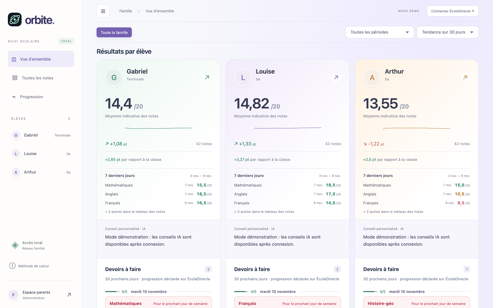
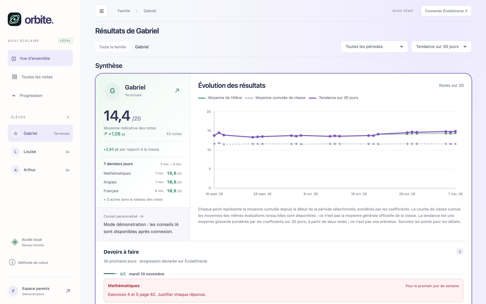

<p align="center"></p>

# Orbite · Tableau de bord familial ÉcoleDirecte

Client web local écrit en TypeScript, exécuté par Node.js 24 ou supérieur (version épinglée dans `.nvmrc` : `nvm use`). Aucune dépendance d'exécution, aucun compte externe. Les seules dépendances npm (TypeScript, types Node, Sass, Prettier, Biome) servent au développement et à la compilation.

Orbite rassemble sur un seul écran les notes, moyennes, tendances et devoirs de tous vos enfants inscrits au collège ou au lycée, à partir de votre compte parent ÉcoleDirecte. Tout tourne sur votre ordinateur (ou un NAS familial) ; seuls les conseils IA, optionnels, transmettent des moyennes anonymes à OpenAI.



*Vue d'ensemble : une carte par élève, avec moyenne, tendance, écart à la classe, dernières notes et devoirs à venir.*



*Vue d'un élève : évolution de sa moyenne comparée à celle de la classe, avec la tendance glissante sur 14 ou 30 jours.*

Captures réalisées en mode démonstration, avec des élèves et des notes fictifs.

## Lancer

Dans ce dossier, une première fois :

```sh
npm install
```

Puis à chaque lancement (la compilation vers `dist/` est automatique) :

```sh
npm start
```

Ouvrir **http://127.0.0.1:3210**. Cliquer sur **Explorer la démo** pour découvrir les trois profils fictifs du secondaire, ou **Connecter ÉcoleDirecte** pour saisir votre compte parent directement dans l’application.

Le fichier `Demarrer.command` permet également un lancement par double-clic sur macOS. Garder le terminal ouvert ; Ctrl+C arrête le serveur. Les identifiants ne doivent pas être envoyés dans une conversation.

Si le port est occupé :

```sh
PORT=3211 npm start
```

## Connexion

- Compte parent ou élève ÉcoleDirecte classique.
- Initialisation GTK et conservation des cookies de routage.
- Questions de sécurité et réponses décodées en français ; prise en charge de plusieurs questions successives, avec limite de sécurité.
- Code TOTP à six chiffres.
- Rotation des jetons et changement de contexte pour plusieurs comptes/établissements rattachés au même identifiant.
- Fin de session explicite et reconnexion en cas d’expiration.
- Pas de prise en charge des connexions SSO, EduConnect ou QR code.

Les mots de passe sont conservés en mémoire uniquement pendant la vérification, puis supprimés après connexion réussie. Les jetons, cookies de session et identités minimales des comptes sont sauvegardés chiffrés ; notes et devoirs restent en mémoire. La session locale dure au maximum huit heures, une vérification en attente dix minutes. Rien n’est écrit en localStorage. Un redémarrage restaure les sessions authentifiées non expirées, sans prolonger leur durée. Le navigateur peut proposer son propre gestionnaire de mots de passe, indépendamment de l’application.

## Tableau de bord

Vue familiale et vue individuelle, toutes les notes de l’année renvoyées par ÉcoleDirecte, filtres par période et matière, recherche d’évaluation, affichage adapté aux écrans étroits, courbes de progression, comparaison à la classe et points d’attention par matière. Les prénoms du mode démo sont fictifs : les enfants réels sont découverts depuis votre compte.

- **Moyenne générale calculée** : calculée comme sur le bulletin. Les notes numériques sont ramenées sur 20 et pondérées par leur coefficient pour obtenir une moyenne par matière. Quand ÉcoleDirecte fournit les coefficients des sous-matières (Anglais › Écrit, Anglais › Oral), la matière est la moyenne pondérée de ses sous-matières. La moyenne générale est ensuite la moyenne des matières pondérée par les coefficients de l’établissement (par exemple philosophie coef. 8). Une matière de coefficient 0 ne compte pas ; sans coefficients connus, chaque matière compte pour 1.
- **Moyenne officielle** : remplace la moyenne calculée d’une fiche lorsque vous choisissez une période précise et que l’API fournit sa moyenne générale.
- **Moyennes par matière** : dans la vue d’un élève, un tableau donne pour chaque matière et sous-matière son coefficient, la moyenne calculée, la moyenne officielle d’ÉcoleDirecte (pour contrôle), la moyenne de classe et le nombre de notes.
- **Évolution** : moyenne générale actuelle moins la moyenne générale d’il y a 30 jours (ou 14), c’est-à-dire calculée sans les notes de cette fenêtre. Il faut au moins une note avant la fenêtre. Le filtre de période s’applique avant ce calcul.
- **Mini-courbes individuelles** : évolution chronologique de la moyenne générale calculée dans chaque fiche.
- **Écart à la classe** : moyenne générale de l’enfant moins celle de la classe, calculées de la même façon, uniquement sur les évaluations possédant les deux valeurs, ramenées sur 20.
- **À accompagner** : matière dont la moyenne a baissé d’au moins un point sur la fenêtre choisie.
- ABS, notes en lettres, notes non significatives, barèmes invalides et coefficients nuls restent hors calcul. Les données absentes ne sont jamais transformées en zéro.

Pas de classement entre frères et sœurs. Les indicateurs visent à alimenter un échange familial et à rendre les efforts visibles.

Les notes sont actualisées manuellement, avec un cache de 60 secondes pour éviter de multiplier les appels. Une erreur sur un enfant est signalée sans remplacer ses données par la démo. Les erreurs de session déclenchent une reconnexion.

## Sécurité et périmètre

Serveur attaché exclusivement à `127.0.0.1`, contrôle du Host et de l’Origin, cookie HttpOnly/SameSite=Strict, en-tête spécifique obligatoire sur les POST, protection contre les connexions répétées, taille des requêtes limitée, opérations ÉcoleDirecte sérialisées, fichiers servis sur liste blanche, CSP et absence de télémétrie/CDN. Aucun secret dans les logs ou dans les réponses au navigateur. L’application n’effectue aucune modification des notes ni envoi de message.

Les utilisateurs ayant accès à votre session macOS et à votre navigateur ouvert peuvent voir le tableau de bord. Se déconnecter après usage sur un ordinateur partagé. Ne pas exposer ce serveur sur Internet ni le placer derrière un proxy public sans revoir l’authentification locale.

## Vérification et limites

```sh
npm test               # compile puis exécute les tests TypeScript
npm run lint           # analyse statique (Biome)
npm run check          # types, lint, formatage et tests
npm run test:coverage  # tests avec rapport de couverture de src/
```

`npm install` active le hook Git `.githooks/pre-commit`, qui lance `npm run check`
avant chaque commit (contournement ponctuel : `git commit --no-verify`). La même
vérification tourne dans GitHub Actions (`.github/workflows/ci.yml`) à chaque push
sur `main` et à chaque pull request, avec la version de Node de `.nvmrc`.

21 tests automatisés réussis : protocoles de connexion simulés, QCM, TOTP, rotation des jetons, expiration, comptes multiples, données partielles, calculs et protections HTTP. Les tests HTTP invoquent le gestionnaire directement sans ouvrir de socket.

**La connexion à un vrai compte n’a pas été validée** : aucun identifiant familial n’a été utilisé. Dans l’environnement de création, l’écoute du port local a été refusée (`EPERM`) ; le rendu n’a pas pu être inspecté dans un navigateur. Il reste donc un essai de connexion et un contrôle visuel sur le Mac à effectuer.

L’API ÉcoleDirecte utilisée est privée et non officielle ; elle peut évoluer. Le comportement est fondé sur les sources communautaires consultées le 7 novembre 2026, notamment :

- https://github.com/EduWireApps/ecoledirecte-api-docs
- https://github.com/jeromeboivin/EcoleDirecteMCP/blob/main/src/ecoledirecte/auth/service.ts

Version API par défaut : `4.96.3`. Si ÉcoleDirecte refuse explicitement cette version, démarrer avec la version utilisée par son site :

```sh
ED_API_VERSION=VERSION_OBSERVEE npm start
```

Les paramètres de visibilité remontés par l’API sont pris en compte pour les principales options des notes et moyennes ; les règles particulières de publication d’un établissement peuvent nécessiter une adaptation.

## Organisation

- `src/server/server.ts` : serveur HTTP local, sessions et table des routes `/api/*` (une route inconnue répond 404).
- `src/server/ecoledirecte.ts` : transport, authentification, comptes et normalisation des notes. Les réponses ÉcoleDirecte sont filtrées par des gardes (listes et objets attendus) : une réponse mal formée produit un message d'erreur par élève, jamais un plantage.
- `src/server/openai.ts`, `src/server/session-store.ts` : IA côté serveur et coffre chiffré.
- `src/server/restart-nas.ts` : redémarrage ciblé sur le NAS.
- `src/shared/types.ts` : types du domaine partagés (notes, périodes, élèves, devoirs).
- `src/shared/metrics.ts` : calculs isolés et testables, communs au serveur et au navigateur.
- `src/client/app.ts` : point d'entrée navigateur (écouteurs et démarrage), qui assemble :
  - `state.ts` : état partagé de l'interface ;
  - `views.ts` : rendu du tableau de bord et du tableau des notes ;
  - `actions.ts` : appels au serveur, chargements et connexion ;
  - `charts.ts`, `homework-panel.ts`, `coaching-panel.ts` : courbes, devoirs et conseils IA des cartes ;
  - `format.ts`, `dom.ts` : mise en forme des valeurs et accès au DOM ;
  - `ai.ts`, `coaching.ts` : appel de l'IA et préparation des conseils.
- `src/client/demo.ts` : données fictives déterministes.
- `src/styles/` : thème clair pastel et responsive en SCSS, compilé vers `dist/style.css`.
- `public/` : `index.html` et favicon.
- `dist/` : JavaScript compilé, généré par `npm run build`, non suivi par Git.
- `test/` : tests TypeScript via `node:test`.

## Mise à jour : collège et lycée

Seuls les élèves du collège ou du lycée sont conservés dans le tableau de bord et les appels aux notes. Les classes de primaire, de maternelle et les niveaux non reconnus sont exclus de cette vue. Aucun compte n’est supprimé chez ÉcoleDirecte.

Les photos disponibles dans le profil ÉcoleDirecte remplacent les initiales dans les fiches, la navigation et devant le prénom dans chaque ligne des notes. Elles sont chargées en HTTPS depuis les domaines ÉcoleDirecte uniquement. Une initiale reste affichée si la photo est absente ou ne charge pas. Aucun portrait réel n’est stocké dans le projet ou l’archive.

Couleurs du tableau : vert à partir de 14/20, orange de 10 inclus à 14 exclu, rouge en dessous de 10. Le calcul tient compte du barème (7/10 est vert). Les notes non chiffrées ou exclues restent neutres. Une légende indique les seuils.

Après cette mise à jour, arrêter le processus existant avec Ctrl+C, relancer `npm start`, recharger la page et se reconnecter pour récupérer les photos. La version précédente connectée a pu être observée ; les nouvelles photos restent à vérifier après redémarrage.

## Interface claire et notes sur 20

Le graphique collectif « Les progrès prennent forme » a été supprimé. Les mini-courbes propres à chaque enfant restent dans leurs fiches. Les colonnes Note et Classe sont toutes deux converties sur 20, sans modifier les notes d’origine ni les coefficients. Les absences et valeurs indisponibles restent signalées sans conversion artificielle.

L’interface utilise désormais des fonds clairs, des cartes pastel, des chiffres plus grands et des libellés adaptés aux enfants. Le rendu a été vérifié dans la session connectée, ainsi que la conversion réelle de 5/5 en 20/20 et de la moyenne de classe 4,67/5 en 18,68/20. Une actualisation du navigateur suffit pour cette mise à jour.

## Libellés et présentation

Titres factuels : Tableau de bord, Résultats par élève, Synthèse, Baisses récentes par matière et Toutes les notes. Suppression des slogans, sous-titres décoratifs, encouragements génériques et illustration orbitale de l’accueil. Espacements réduits ; thème clair conservé.

## Serveur sur le réseau local (optionnel)

Le serveur écoute `127.0.0.1` par défaut. Pour le rendre accessible aux autres
appareils de la maison (par exemple depuis un NAS ou un mini-PC sous Linux), définir
dans le `.env` du serveur `HOST` (adresse réseau de la machine, ajoutée à la liste
des hôtes autorisés) et `PORT`. Le contrôle d'origine reste actif.

Sur la machine serveur, il suffit de Node 24 ou supérieur et des dossiers `dist/`
(produit par `npm run build`) et `public/`, avec `package.json`, `start-nas.sh` et
`.env` : ni TypeScript ni `node_modules`. Deux scripts facilitent l'exploitation
sous Linux :

```sh
# Démarrage (ORBITE_NODE : chemin de Node s'il n'est pas dans le PATH)
ORBITE_NODE=/chemin/vers/node nohup sh start-nas.sh > orbite.log 2>&1 &

# Après une mise à jour des fichiers : arrêt propre puis relance
/chemin/vers/node dist/server/restart-nas.js
```

`restart-nas.js` lit `HOST` et `PORT` dans le `.env`, arrête uniquement le serveur
Orbite de ce dossier (même exécutable Node, marqueur `ORBITE_NAS_INSTANCE` ou port
configuré), le relance détaché et vérifie qu'il répond. Son journal va dans
`ORBITE_LOG` (défini dans le `.env`) ou, à défaut, dans `orbite.log` à la racine du
projet. Les sessions non expirées sont restaurées. Le coffre de sessions est lié au
port : changer de port peut demander une reconnexion.

Cet accès HTTP est destiné uniquement au réseau domestique de confiance : le trajet
navigateur-serveur n'est pas chiffré. Ne pas rediriger ce port sur Internet et
réserver l'adresse de la machine dans le DHCP du routeur. Le démarrage automatique
au boot dépend du système de la machine et reste à configurer.

## Devoirs à faire

Chaque synthèse contient les devoirs non cochés comme faits dans le cahier de
textes, triés par échéance : matière, consigne, date complète, repères Aujourd'hui
et Demain, évaluations à préparer et noms des pièces jointes disponibles sur
ÉcoleDirecte. Tous les éléments retournés sont affichés, sans limite arbitraire.

La liste de l'API commence aujourd'hui : elle ne garantit pas l'historique des
devoirs en retard. Le statut « effectué » est déclaratif. Un statut absent est
signalé comme non renseigné. Les devoirs ne suivent pas les filtres des notes.
Les erreurs du cahier sont indépendantes de celles des notes. Les détails
indisponibles sont signalés ; une erreur ne devient jamais une liste vide.
Le HTML des consignes est converti en texte et échappé à l'affichage.
Aucune écriture ni modification de statut sur ÉcoleDirecte.
Les appels restent séquentiels pour respecter la rotation des jetons.

Les tests couvrent notamment filtrage, dates, détails incomplets,
expiration et erreurs partielles. Les devoirs réels restent à valider après
déploiement et reconnexion.

## Chargement progressif

La connexion et la vérification affichent immédiatement un indicateur d'attente.
Après authentification, le formulaire disparaît et le tableau affiche un loader
pendant la récupération des notes. Les devoirs sont chargés ensuite, élève par
élève, via /api/homework, avec un cache indépendant de 60 secondes et le même
verrou de session pour préserver la rotation des jetons. Seul le bloc de devoirs
est mis à jour ; la navigation, les filtres et la recherche restent utilisables.
Les réponses périmées après changement de session sont ignorées.
32 tests passent, dont attente réseau simulée, erreurs de connexion, chargement
différé, contrôle des élèves autorisés, verrou et cache.

## Devoirs : dates, progression et pagination

Chargement initial : aujourd'hui et les 29 jours suivants (calendrier de Paris).
L'index léger de l'API est nécessaire pour connaître les dates et statuts ; seules
les consignes de cette fenêtre sont demandées. Les devoirs suivants arrivent par
lots de cinq, pour l'élève sélectionné, sans recharger les notes. Les détails d'une
même journée sont réutilisés entre lots. Les compteurs journaliers utilisent tous
les statuts de la journée, y compris les devoirs cochés comme faits. Un statut
inconnu n'est pas compté comme fait et est signalé.
Séparateurs de dates et barres faits/total. Rouge : prochaine date du lundi au
vendredi, donc lundi depuis vendredi, samedi ou dimanche. Cette règle ne déduit
ni vacances ni jours fériés. Bordure de sélection portée par le conteneur complet.
36 tests passent ; bordure vérifiée dans le navigateur. Redémarrer le serveur
pour activer la nouvelle pagination côté API. Les anciennes réponses n'affichent
pas de faux compteurs de progression.


## Sessions persistantes chiffrées

Activées automatiquement au démarrage du serveur. Coffre AES-256-GCM avec nonce
aléatoire, écrit atomiquement et synchronisé avant la réponse API. Clé aléatoire
locale de 32 octets, fichiers 0600 et dossier 0700. Répertoire par défaut :
.orbite-data/PORT/ à la racine du projet (donc indépendant du dossier courant).
ORBITE_DATA_DIR permet d'utiliser un emplacement durable dédié, hors partage
public. Ne pas utiliser le même dossier pour deux serveurs simultanés.
La clé et le coffre doivent rester ensemble sur le même appareil. Ce chiffrement
ne protège pas contre une personne ayant accès au compte système ou root et à
la clé. Le coffre, la clé et les fichiers temporaires ne sont ni servis par HTTP,
ni inclus dans l'archive de sources, ni suivis par Git.

Seules les sessions authentifiées sont sauvegardées : identifiant du cookie
local, expiration absolue, jetons, cookies ÉcoleDirecte, contexte actif et champs
explicitement autorisés des comptes/élèves. Aucun mot de passe, code OTP,
question/réponse de sécurité, état de connexion en attente, notes ou devoirs.
La session expire toujours huit heures après authentification ; un redémarrage
ne prolonge rien. Un jeton révoqué par ÉcoleDirecte demande une reconnexion.
Une déconnexion ou une expiration retire la session du coffre. Si le coffre est
corrompu ou sa clé absente, le lancement échoue sans l'écraser. Une erreur de
sauvegarde renvoie une erreur explicite, jamais une réussite silencieuse.

SIGINT et SIGTERM laissent finir les requêtes actives avant l'arrêt. Chaque
réponse API sauvegarde les dernières informations d'authentification. Un arrêt
forcé au milieu d'une rotation de jeton peut nécessiter une reconnexion.
Pour la première migration seulement, redémarrer puis se reconnecter une fois :
l'ancienne version ne peut pas transmettre ses sessions en mémoire.
Les redémarrages suivants restaurent la session avec le même cookie navigateur.
La persistance ne rend pas le redémarrage sans interruption : le serveur reste
brièvement inaccessible pendant le remplacement du processus.

40 tests passent, dont chiffrement, altération, permissions, absence de secrets
de connexion, restauration avec le même cookie, rotation, déconnexion durable
et expiration. Le test de redémarrage recrée le serveur et son client depuis le
coffre sans appel à ÉcoleDirecte.

## OpenAI côté serveur

Créer un fichier `.env` à côté de `server.js` à partir de `.env.example`, puis
renseigner `OPENAI_API_KEY` et éventuellement `OPENAI_MODEL` (défaut :
`gpt-5-mini`). Restreindre les permissions avec `chmod 600 .env`, puis redémarrer
le serveur. La configuration est lue automatiquement ; les variables déjà
présentes dans l'environnement ont priorité. Ne jamais copier cette clé dans
`public/`, un dépôt ou une archive distribuée.

Le front peut appeler le même serveur, sans clé :

```ts
import { askAI } from './ai.ts'; // depuis src/client/, servi en /client/ai.js
const {text, complete, refused, usage} = await askAI(
  'Propose une méthode pour organiser une semaine de révision.'
);
// Pour afficher du texte brut : element.textContent = text;
```

Route : `POST /api/ai`, JSON `{"input":"Votre demande"}` avec cookie de session
et en-tête `X-Orbite-Client: 1` (gérés par le helper). Une session ÉcoleDirecte
entièrement authentifiée est requise. Réponse : `text`, `complete`, `refused`,
`usage.inputTokens` et `usage.outputTokens`. Les erreurs ont un champ `error`.
Le modèle et les instructions sont définis exclusivement côté serveur.

Seul le texte fourni est envoyé à OpenAI, accompagné des instructions fixes :
aucune transmission automatique des notes, devoirs ou identifiants. La requête
utilise l'API Responses avec `store: false`, sans historique ni outils. Cette
option désactive le stockage des réponses pour récupération via l'API ; elle
ne constitue pas une garantie d'absence de toute rétention chez OpenAI.
La clé et les erreurs brutes du fournisseur ne sont jamais renvoyées au front.

Limites : 8 000 caractères, corps HTTP de 16 Kio maximum, 2 048 jetons de sortie
(y compris raisonnement), délai de 45 secondes. Une requête simultanée par
session, deux par serveur ; dix demandes/minute/session et trente/minute au
total. Ces compteurs en mémoire sont réinitialisés au redémarrage. L'IA ne bloque
pas le chargement ÉcoleDirecte. La facturation API est distincte de ChatGPT.

46 tests passent, dont appels OpenAI simulés, accès authentifié, protections
CSRF, quotas, confidentialité des réponses et coexistence avec le tableau de
bord. Un appel réel nécessite une clé configurée sur le serveur.

## Conseil personnalisé par élève

Un court conseil IA apparaît sous la moyenne et la tendance, avant les devoirs.
Il se charge en différé pour les cartes visibles, sans bloquer notes, filtres ou
devoirs. Le texte est adressé à l'élève : encouragement en hausse, priorité
concrète en baisse, conseil de progression en stabilité. Une tendance inconnue
n'est jamais assimilée à une stabilité. Le seuil de stabilité est 0,05 point,
comme la flèche du tableau de bord. Affichage limité à trois lignes ; texte
complet disponible au survol et dans le contenu accessible.

Cette fonctionnalité transmet automatiquement à OpenAI les agrégats nécessaires
pour les élèves affichés : moyenne, tendance, effectifs, écarts à la classe et
résultats par matière (jusqu'à douze). Elle n'envoie ni noms, identifiants,
photos, libellés d'évaluations, devoirs ni identifiants de connexion. Les données
suivent la période scolaire et la fenêtre de tendance choisies. Il n'y a aucun
appel en démonstration ou sans note exploitable. La route générique /api/ai
continue à ne joindre aucun contexte de son propre chef.

Les demandes sont sérialisées et dédoublonnées dans un cache mémoire de l'onglet,
indexé par élève et contexte. Changer de filtre ne répète pas une demande déjà
faite pour les mêmes résultats. Les réponses obsolètes ne sont pas affichées.
Les échecs ne déclenchent aucune boucle de tentatives : recharger la page permet
de réessayer. Si l'IA est indisponible, un message discret remplace le conseil.
Le texte généré est inséré via textContent, jamais interprété comme du HTML.

49 tests passent (API simulée), dont tendances, absence d'identité dans le
contexte transmis, sérialisation, cache et abandon des demandes obsolètes.
Redémarrer Node puis recharger la page pour servir le nouveau module coaching.js.

## Graphique individuel détaillé

Dans le filtre d'un élève, la petite courbe est remplacée par un graphique dédié
sur toute la largeur : dates à l'échelle, axe des notes sur 20, points par
évaluation, moyenne pondérée quotidienne, moyenne de classe quotidienne des
évaluations disponibles et tendance glissante pondérée sur 14 ou 30 jours.
La tendance exige deux notes dans la fenêtre et ne prédit pas les résultats.
Les valeurs absentes interrompent les séries. Les notes hors calcul ou sans
date exploitable sont exclues. L'échelle inclut 0 à 20 et s'étend si des bonus
excèdent 20. Les points proposent des détails au survol et des libellés
accessibles ; le graphique défile horizontalement sur petit écran.
51 tests passent, dont normalisation des barèmes, coefficients, plusieurs notes
le même jour, classe manquante et fenêtres de tendance. Recharger la page suffit.

## Moyennes cumulées et interface simplifiée

Le graphique individuel cumule désormais toutes les notes éligibles depuis le
début de la période sélectionnée, avec leurs coefficients. La classe cumule les
moyennes disponibles des évaluations correspondantes, sans remplacer une valeur
absente par zéro. Ce n'est pas la moyenne générale officielle de la classe.
Les points de notes individuelles sont retirés ; la troisième courbe conserve
la tendance glissante sur 14 ou 30 jours. 52 tests passent.

Les quatre blocs de compteurs et la mention Session locale ont été retirés.
Le bouton de navigation en haut à gauche replie/déplie la sidebar ; son état est
mémorisé localement. Les menus de période ont une flèche dédiée, un espacement
réservé et des couleurs explicites. Courbes, filtre de période et repli vérifiés
dans le navigateur. Recharger la page suffit.

## Notes des sept derniers jours

En bas de chaque encart coloré : trois notes chiffrées au maximum, les plus
récentes entre aujourd'hui et J−6 inclus (calendrier de Paris), avec matière,
date et note sur 20. Les autres sont signalées par un compteur. La sélection
utilise les notes de l'élève indépendamment du filtre de période, afin de garder
une fenêtre fixe de sept jours. Un état vide est affiché en l'absence de notes.
54 tests passent, dont bornes inclusives, limite à trois et changement de jour
à Paris. Recharger la page suffit.

## Alignement et sous-matières

Les cartes familiales partagent leurs trois lignes via CSS subgrid : encart
coloré, conseil IA, devoirs. Les hauteurs variables dues aux trois dernières
notes ou aux noms de classe ne décalent plus le début des sections voisines.
Une disposition de repli reste disponible sans subgrid.

Les notes utilisent désormais les disciplines de la période pour résoudre la
matière parente par codeMatiere et la sous-matière par codeSousMatiere. Le libellé
composé (ex. ANGLAIS LV1 · Oral) est utilisé dans le tableau, les dernières notes,
les filtres, les alertes et le contexte IA. Sans référentiel exploitable, le code
parent est conservé plutôt qu'une matière devinée. Deux sous-matières Oral
appartenant à des langues différentes restent distinctes. 56 tests passent.
Redémarrer Node puis actualiser les données pour appliquer cette normalisation.


## TypeScript

Tout le code (serveur, navigateur, tests) est écrit en TypeScript strict
(`strict`, `noUncheckedIndexedAccess`, `exactOptionalPropertyTypes`,
`noImplicitReturns`, `noImplicitOverride`, `verbatimModuleSyntax`,
`erasableSyntaxOnly`). Les imports relatifs utilisent l'extension `.ts`, réécrite
en `.js` à la compilation. Trois configurations :

- `tsconfig.json` : contrôle de types de `src/` et `test/`, utilisé par l'éditeur ;
- `tsconfig.build.json` : compilation de `src/` vers `dist/` ;
- `tsconfig.client.json` : vérifie que le code navigateur n'utilise aucune API Node.

Le navigateur et le NAS exécutent uniquement `dist/`, en JavaScript ES2023 : le
NAS n'a besoin ni de TypeScript ni de `node_modules`. Les tests s'exécutent
directement en TypeScript grâce au retrait des types natif de Node.

Scripts : `npm run build`, `npm start`, `npm run dev` (recompilation et
redémarrage automatiques), `npm run typecheck`, `npm run lint`, `npm test`,
`npm run test:coverage`, `npm run format`, `npm run check`.

Les fichiers servis au navigateur deviennent `/client/*.js` et
`/shared/metrics.js`, toujours sur liste blanche. Le coffre de sessions et `.env`
restent à la racine : les sessions existantes sont conservées. `restart-nas`
retrouve aussi bien les anciennes instances (`server.js`) que les nouvelles
(`dist/server/server.js`). Après mise à jour sur le NAS, la première exécution
de `restart-nas` doit donc être celle de `dist/server/restart-nas.js`.

57 tests passent, identiques à la version JavaScript ; le mode démonstration a
été vérifié dans le navigateur à partir de la version compilée.

## Styles SCSS

La feuille de style est écrite en SCSS dans `src/styles/` et compilée par Dart
Sass (dépendance de développement) vers `dist/style.css`, toujours servie en
`/style.css`. `main.scss` charge les modules (`@use`) dans l'ordre de la cascade :

- `_variables.scss` : palette, couleurs des notes et des courbes, accents des
  cartes élèves, largeurs de la barre latérale et points de rupture ;
- `_mixins.scss` : accent de carte, requêtes média, séries de graphique ;
- `_base`, `_sidebar`, `_layout`, `_cards`, `_weekly-notes`, `_homework`,
  `_panels`, `_chart`, `_card-layouts`, `_dialog` : un module par zone ;
- `_responsive.scss` : surcharges pour écrans étroits, en dernier.

Les couleurs utilisées à l'exécution (`--accent`, `--line`, `--muted`…) restent
des propriétés CSS personnalisées. `npm run build` compile aussi les styles ;
`npm run dev` les recompile à chaque modification. Le CSS produit est identique
à la feuille d'origine (vérifié par comparaison des sorties compilées).

## Licence

[MIT](LICENSE) © 2026 Thomas Fauré. Projet indépendant, non affilié à
ÉcoleDirecte ; fourni tel quel, sans garantie de fonctionnement si l'API privée
d'ÉcoleDirecte évolue.
